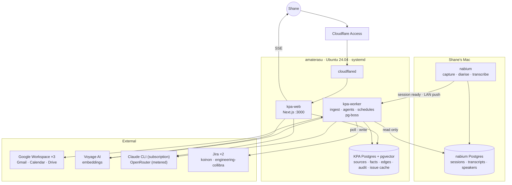
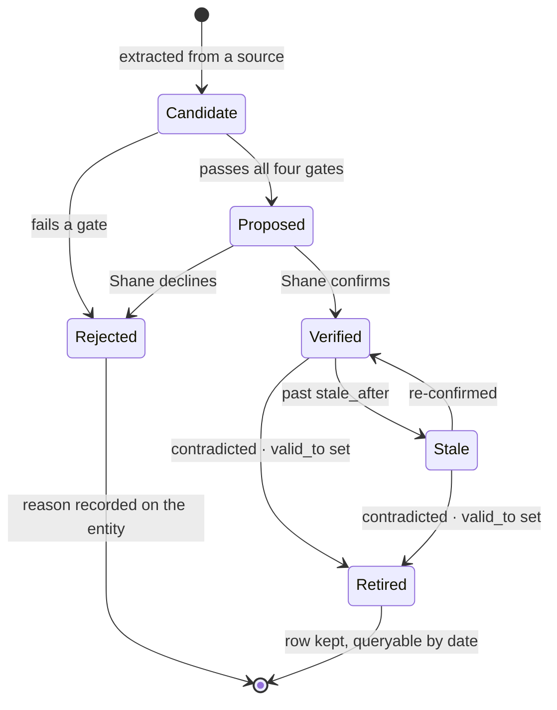
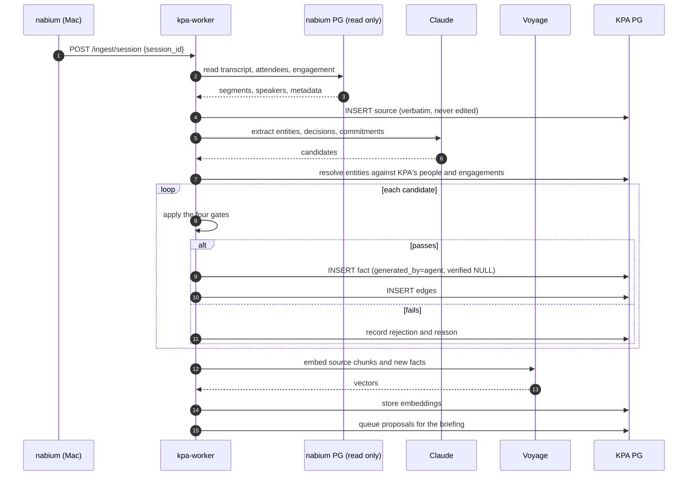
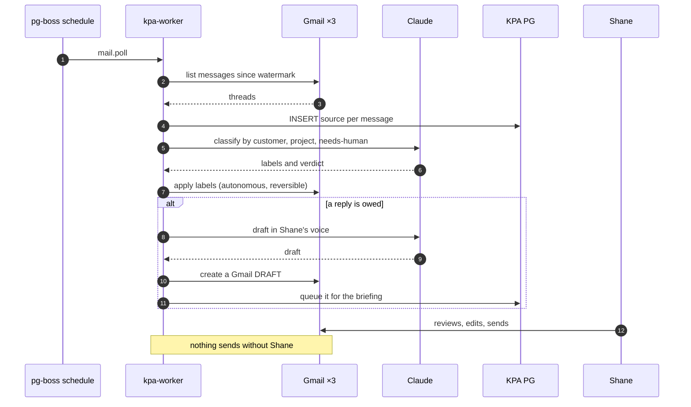
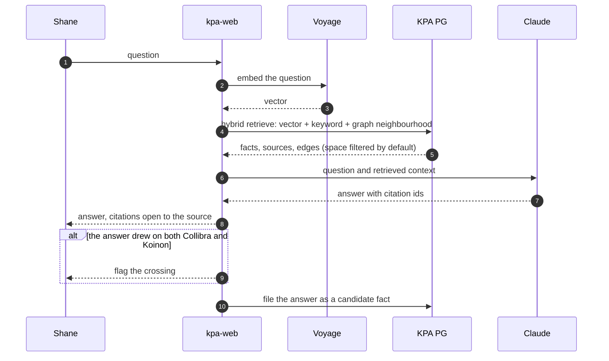
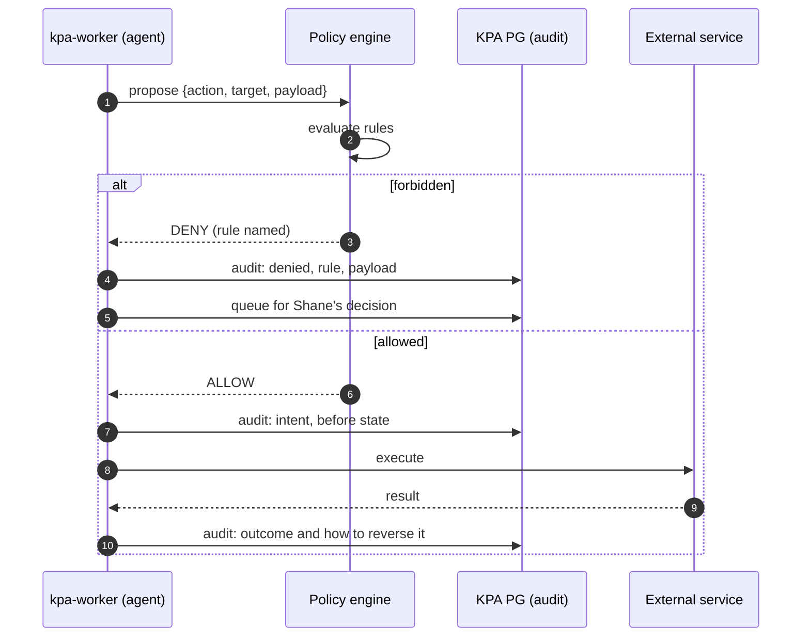

# Koinon Personal Assistant: project brief

**Status:** draft, in active discovery. Sections marked *Open* hold questions
not yet answered.

**Jira project:** KPA, `koinon.atlassian.net`. Empty as of 23 August 2026. It
becomes the source of work once this brief settles.

**Last updated:** 23 August 2026

---

## What we are building

A hosted web application that acts as Shane Dolley's personal assistant. It runs
on a machine he owns, connects to every mailbox and chat account he uses, ingests
meeting transcripts from nabium, and maintains a memory that learns and corrects
itself.

He works with it daily. That is the test the product has to pass: not whether it
demonstrates well, but whether he opens it every morning by choice.

## The problem

Shane works across two organisations with a hard wall between them. Collibra
employs him and its customer material is confidential. Koinon Engineering is his
own company with its own clients and commercial figures. A third stream is
personal. Today the context for all three lives in his head, in three mailboxes,
in meeting recordings nobody rewatches, and in a small markdown vault.

Three failures follow.

**Context evaporates.** A decision made in a meeting in March is unavailable in
August unless he happens to remember it. The recording exists and nobody will
watch it again.

**Recall costs attention.** Finding what a customer agreed to means searching
three mailboxes by hand, and searching well enough to trust the answer takes
longer than the answer is worth.

**Facts rot silently.** A contact leaves, a contract term changes, a system gets
retired. Nothing announces it, so stale knowledge is indistinguishable from
current knowledge until it causes a mistake in front of a customer.

## What it does

Four jobs, all confirmed.

**Triage and draft mail.** File by customer and project across every account,
flag what needs a human, draft replies in Shane's voice ready to edit and send.

**Turn meetings into memory.** Take nabium's transcripts, extract decisions,
commitments and action items, attach them to the right customer and engagement,
and surface what was agreed.

**Answer from everything at once.** One question, searched across three
mailboxes, every transcript and the whole fact graph, answered with citations
that open.

**Chase and remind.** Track what Shane owes people and what people owe him,
notice when a promised reply never came, and prompt before a deadline lands
rather than after.

### The screen he opens

A briefing dashboard, generated. What happened overnight, what needs him, what
is decaying, what the system proposes. Chat sits one click away for digging in.

```
┌─ Tuesday 25 Aug ────────────────┐
│ Needs you (3)                   │
│  • BHP Meridian: retention Q    │
│  • Maybank SOW unsigned         │
│ Proposed facts (4)   [y][n]     │
│ Meetings today (2)              │
│ Stale facts (2)                 │
└─────────────────────────────────┘
```

### How much it does alone

Autonomous within policy. It acts on its own inside rules Shane sets, logs
everything, and he audits after the fact.

This is a deliberate departure from the markdown system, whose governing
principle is that the default is to write nothing. Two consequences follow and
the design has to carry them.

The policy layer becomes load bearing. It is the only thing standing between an
autonomous agent and Shane's sent-mail folder, so it needs to be explicit,
inspectable and testable rather than a set of prompt instructions.

The audit log becomes the safety net. If nobody approves an action beforehand,
the record of what happened has to be good enough to catch a mistake afterwards,
and it has to be somewhere Shane actually looks.

### The policy

Four rules, and the first two are absolute.

**It never sends mail unprompted.** It may draft anything and queue it. A
message leaves the box only after Shane clicks. This is the highest blast radius
action available to it and the hardest to walk back.

**It never deletes or destructively edits.** No deleting mail, no deleting facts,
no overwriting history. It retires and supersedes instead, so anything wrong
stays recoverable.

**It never marks its own facts verified.** The markdown system's rule carries
forward. It writes facts autonomously, and everything it asserts stays on the
review queue until Shane confirms it. The queue is work, and that work is what
keeps the memory trustworthy.

**It keeps Collibra and Koinon apart as a guideline.** Retrieval filters by space
by default and the system flags any answer drawing across the two, but nothing in
the database prevents it. See *Risks accepted*.

## Accounts

Three Google Workspace accounts, all already authorised through the `google` MCP
server, `workspace-mcp`, at user scope. Gmail, Calendar and Drive on each. The
OAuth client lives in Google Cloud project `personal-assistant-506014`, owned by
the Koinon account, with refresh tokens in `~/.google_workspace_mcp/credentials`.

| Account | Serves | Note |
|---|---|---|
| `shane@koinon.com.au` | Koinon Engineering | Also receives mail sent to `shane@thekoinon.com` |
| `shane.dolley@collibra.com` | Collibra | Authorised 20 August 2026 with no admin block. The tenant can revoke it. |
| `shanevdolley@gmail.com` | Personal | |

The OAuth work is done and KPA inherits it rather than repeating it. The Collibra
grant is the fragile one: it exists because nobody blocked it, not because
anybody approved it.

**Initial ingestion reaches back six months.**

### Scope per service

| Service | Access | Notes |
|---|---|---|
| Gmail | Read and draft | Drafts queue for Shane. Sending is never automatic. |
| Calendar | Read and write | It links meetings to engagements, spots conflicts, holds time, and can accept invitations. |
| Drive | Read and write | It creates, edits and reorganises documents on direction. It never deletes. Google's own revision history is the recovery mechanism, which is what keeps the destructive-edit rule intact. |

### Microsoft, Teams and customer tenants

The stated goal names Outlook and Teams. All three mailboxes are Google, so the
Microsoft surface is customer tenants where Shane is a guest: BHP, TfNSW, Sydney
Water and others.

**Graph access to those tenants is not obtainable and KPA will not pursue it.** A
third-party application reading Teams messages needs an application registration
and admin consent inside the resource tenant. A guest user cannot self-consent,
and enterprises of that size block third-party consent by default. Asking is a
conversation with a customer's IT department that ends in a refusal.

Nabium already solves this without asking anyone. It captures meetings from the
desktop on any platform, because it records what Shane can already see and hear,
and ADR-0003 extends the same approach to Teams messages. **All customer-tenant
material reaches KPA through nabium.**

## Prior art: the markdown system

A working system already exists across two repositories, and it earned its design
through use. The new product inherits its principles rather than replacing them.

`~/Development/personal/personal-assistant` holds the machinery: a journal
rendered from Claude Code transcripts, three scheduled jobs under launchd, Gmail
filter rules, and the reports those jobs produce.

`~/Development/obsidian_vaults/Memory` holds the knowledge: 17 compiled facts
across four spaces, and 32 raw sources they were compiled from.

### What carries forward

**Three layers, each with one job.** Sources hold raw material and are never
edited. Facts are compiled out of sources, one fact per record. Conventions
govern both. Nothing writes into two layers.

**Four gates decide whether a candidate becomes a fact.**

1. It will still be true in a month.
2. It appeared on two separate days, or Shane stated it once as a preference, a
   correction, or a decision.
3. Nothing already records it.
4. It contradicts nothing, or it retires what it contradicts.

**Reconcile before appending.** Pull the entities out of new material, open every
record naming one of them, rewrite what the new material contradicts, and only
then consider what is genuinely new. Appending first leaves two answers standing
and a reader cannot tell which one is current.

**A machine never marks its own work verified.** `generated_by` records who wrote
a fact and `verified_by` records who confirmed it. They stay separate, and
scheduled jobs never set the second. Anything a machine asserted stays on the
review queue until Shane clears it.

**Staleness is an absolute date, not a duration.** Every fact with a natural
review point carries one, picked from the fact rather than from the day it was
written. A batch given the same horizon on the same afternoon all falls due
together, and a queue that arrives at once is one nobody works through.

**Fix what can be proven wrong, propose everything else.** A broken link has one
right answer. A restructure does not, and a job told weekly to find something to
improve will find something forever. A refusal is recorded on the record it
concerned, with the reason, so a later run does not raise it again.

**Uncertainty is recorded, never guessed away.** An empty field asks a question.
A plausible invented answer closes it wrongly and survives for years.

**Never store a secret.** No keys, tokens or connection strings in any layer.
History is permanent, and a record that carried a key once carries it forever.

### What the markdown system cannot do

It has no interface beyond Obsidian and a terminal. It ingests mail only when a
scheduled job runs. It has no path to Outlook or Teams. It cannot handle meeting
recordings at all. Its search is grep, so it cannot answer a question phrased
differently from how the fact was written. And it holds 17 facts, which is a
corpus a person can still hold in their head.

## Nabium

Shane's own macOS meeting recorder, at `~/Development/personal/nabium`. It is
further along than a prototype: three ADRs, runbooks, a whisper model benchmark,
brand assets, and a migrated Postgres schema.

It captures system audio without joining meetings as a bot, takes screenshots
when content is shared, diarises speakers against a persistent voice library,
**transcribes on-device**, and writes engagement-aware markdown summaries into an
Obsidian vault. Per ADR-0003 it also ingests messages from iMessage, Slack,
Teams, Google Chat and Webex.

Its schema already holds `sessions`, `transcripts`, `transcript_segments`,
`transcript_chunks`, `speakers`, `session_attendees`, `people`, `engagements`,
`action_items`, `glossary`, `summaries`, `screenshots` and `pipeline_events`,
with pgvector HNSW indexes.

**Status:** a personal tool. It may become a product later, and that is not
driving decisions today.

### How KPA and nabium meet

Nabium owns capture, transcription, speakers and sessions. KPA owns mail, memory,
the briefing and the agents.

Nabium pushes an event over the LAN when a session is ready. KPA then reads the
detail from nabium's Postgres through a read-only role. Push is the trigger, the
read-only connection is the source.

The cost of reading another system's tables directly is that KPA breaks whenever
nabium migrates its schema. Two things reduce that: KPA reads through database
views it defines rather than through nabium's base tables, and nabium's migration
runbook gains a step that names KPA as a consumer.

### Where the two projects disagree

Nabium's build spec names data sovereignty as its first reason for existing:
transcripts of BHP Ironclad and Meridian workshops should not leave the device.
It transcribes locally on purpose and gates cloud summarisation behind a
per-engagement `allow_cloud_summarisation` flag.

**KPA ignores that flag.** Decided 23 August 2026. Content from every engagement
reaches Claude or OpenRouter regardless of what nabium recorded about it.

The consequence is that the sovereignty guarantee ends at KPA's boundary rather
than continuing through it. Nabium's local transcription still earns its keep,
since it is already built and costs nothing to run, but it no longer protects the
engagements it was written to protect once KPA ingests them. See *Risks
accepted*.

## Decisions settled

Each of these is recorded as an ADR in `docs/adr/`.

| Decision | Choice | Why |
|---|---|---|
| Memory store | PostgreSQL with typed edges and pgvector | The data is a graph, but the queries are neighbourhood queries rather than open traversal. Postgres does those in milliseconds at this scale, and row-level security enforces the Collibra and Koinon separation in the database rather than in application code. Neo4j Community has no role-based access control, so that boundary would live in application code where one missed filter leaks employer customer material. |
| Inference | Claude subscription through the headless CLI, with OpenRouter as the metered path | Reuses the pattern the launchd jobs already prove. No marginal cost on the scheduled work. |
| Local models | None | Rejected 23 August 2026. The hardware holds 7.6 GB of RAM and has no CUDA device, which caps local generation at a 3B model at roughly 10 tokens per second. |
| Deployment | Bare metal on Ubuntu, systemd units | Matches how the existing services on the box run, and spends no RAM on container overhead where RAM is the binding constraint. |
| Runtime | Node | Stated requirement. Framework choice is open. |
| Autonomy | Autonomous within policy | Acts inside rules Shane sets, logs everything, audited after. |
| Nabium integration | Read-only database role, triggered by a LAN push | Cheapest to build, no API to design and maintain across two personal projects. |
| Nabium cloud flag | Ignored by KPA | Shane's call, 23 August 2026. |
| Entity ownership | KPA is canonical, nabium feeds it | KPA sees mail as well as meetings, which is a far wider source of people. Nabium's entities merge in on ingest. |
| Memory vault | KPA replaces it | The 17 facts and 32 sources migrate into Postgres. The vault and its three launchd jobs retire. One system, no sync problem. |
| Collibra and Koinon separation | A guideline, not a database constraint | Decided 23 August 2026. Retrieval filters by space and crossing answers get flagged. Nothing structurally prevents a leak. |
| Remote access | Cloudflare Tunnel with Access in front | Works on any device without installing a client. Traffic transits Cloudflare. |
| Ingestion depth | Six months | Covers current engagements at a bounded one-off cost. |
| Embeddings | Voyage AI, `voyage-4` at 1024 dimensions | Anthropic's own recommendation. This row named `voyage-3` until 27 August 2026, when KPA-26 read Voyage's model list and found it listed as legacy. `voyage-4` over `voyage-4-large` because a corpus of 17 facts and 32 sources cannot show the larger model's quality. Both default to 1024, so moving up later changes a model name and not the schema. Adds a vendor and a key. |
| Time model | Facts carry `valid_from` and `valid_to` | Retirement becomes a date rather than a delete, so the system answers what was true in March and fact decay stays visible. |
| Microsoft Graph | Not pursued | Customer-tenant consent is unobtainable. Nabium's desktop capture covers the same material. |
| Application shape | Next.js for the web tier, a separate worker process for everything long-running | Agent runs and ingestion must never sit in a request handler. The split is load bearing. |
| Job queue | pg-boss, backed by the same Postgres | No Redis, so no second store and no extra RAM on a box where RAM is the constraint. |
| Issue text | The tracker owns it, KPA caches and adapts at the boundary | Jira's ADF is a ProseMirror schema, so the round trip costs a node rename and a second copy earns nothing. Boards Shane shares with colleagues have other writers, and two masters over one rich-text blob do not merge. ADR-0007. |
| Issue editor | TipTap, whose document model is ProseMirror | Every adapter starts one rename from ADF. Slate and Lexical would need a parser instead. ADR-0007. |
| Tracker freshness | Poll on a pg-boss schedule, push to the browser over SSE | Jira refuses webhook registration to an API token, and the admin route needs a permission Shane lacks on the Collibra site. Polling also keeps Cloudflare Access closed, where a webhook would need a bypass on a public path. ADR-0008. |
| First slice | Migrate the memory | Proves the model before any volume reaches it. |
| Jira stories | Spec carrying | Each story states its acceptance criteria, the files it touches, its test, and a definition of done an agent can verify alone. |
| Repository | Git from the first commit, private on GitHub | Matches nabium and the memory vault. The design carries history from line one. |
| Scope of replacement | KPA replaces the whole markdown system | The vault, `journal/`, the three launchd jobs and the Gmail filter rules. Nothing of it keeps running alongside. |
| Gmail labelling | KPA takes it over | The 15 rules in `gmail-filters/collibra.xml` import as the starting policy rather than being rewritten from nothing. |
| Drafting voice | The `draft-email` skill's rules | Already written, already tuned, already covers all three accounts. KPA implements them rather than learning a voice from sent mail. |
| Retirement | Only a source or a human sets `valid_to` | Time alone never retires a fact. The staleness sweep flags and re-confirms. |
| Offline | Rescan on return | No queueing on the Mac and no catch-up logic. When the box comes back it scans from the last watermark, which is the same path a normal poll takes. |
| Backup | Copy nabium's runbook | `docs/runbooks/database-backup.md` already exists and already covers Postgres on this hardware. |
| Employer policy checklist | Not a gate | Shane is the decision maker and has accepted the risk directly. Recorded, not chased. |
| Mail triage rule | Carries forward unchanged | If a person composed the words it stays in the inbox, and the sending address proves nothing. The rule earned itself through use in `docs/mail-triage-method.md`. |
| Identity | WorkOS AuthKit, wired into Cloudflare Access as an OIDC provider | Shane creates and invites accounts in WorkOS. Access still enforces the wall, so the application never sees an unauthenticated request. |
| Users | One, Shane, for now | No permission model, no per-user partitioning, no sharing. The memory model assumes one person throughout: one set of facts, one inbox, one voice, one review queue, and a `verified_by` that means him. |

**A note on the memory store decision.** Row-level security enforcing the
Collibra and Koinon wall was the tiebreaker that chose Postgres over Neo4j. That
wall is now a guideline, so the tiebreaker no longer applies. The decision still
holds on the arguments underneath it: the queries are neighbourhood queries
rather than open traversal, one store beats two, and nabium already runs Postgres
with pgvector so the operational knowledge exists. ADR-001 records this
correction rather than hiding it.

**The embedding model and its width are a migration, not a setting.** A pgvector
column declares a fixed width, so changing either value makes every stored vector
the wrong width and the wrong model's output. `src/embedding.ts` holds both
values in one place for that reason.

## The machine

`amaterasu`, reachable over SSH. A 2018 Mac mini running Ubuntu 24.04.4.

| | |
|---|---|
| CPU | Intel i7-8700B, 6 cores, 12 threads, 3.2 GHz base |
| RAM | 7.6 GB |
| GPU | Intel UHD 630. No CUDA. |
| Disk | 931 GB NVMe, 762 GB free |
| Network | 192.168.20.110 on the LAN |
| Installed | Docker 29.6.1, Compose v5.3.1, ffmpeg 6.1.1, Python 3.12.3, git |
| Absent | Node, PostgreSQL, Claude CLI, Tailscale, a reverse proxy |

**It already works for a living.** It serves NFS, runs NZBGet, and runs a
transcode monitor. Transcoding takes all 12 threads when it fires, and the
assistant has to survive that. A desktop session with Chrome open holds roughly
800 MB.

**RAM is the constraint that will bite first.** Roughly 5 GB is available after
the existing services. PostgreSQL and Node fit inside that today. Years of
ingested mail will not. The machine takes two DDR4-2666 SO-DIMMs to 64 GB and the
upgrade costs a few hundred dollars, which is the cheapest fix available when the
ceiling arrives.

## Architecture

### The shape



Three services under systemd on amaterasu, one Postgres, no containers. The
worker holds every long-running thing: ingestion, agent runs, the nightly review,
the staleness sweep. The web tier reads and serves.

### The three layers of memory

The markdown system's structure survives the move to Postgres.

| Layer | Table | Written by | Edited |
|---|---|---|---|
| Sources | `sources`, `source_chunks` | ingestion, verbatim | never |
| Facts | `facts`, `edges` | an agent, or Shane | revised and retired, never deleted |
| Policy | `policies`, `rejections` | Shane | evolves |

`facts` carries `valid_from` and `valid_to`, so retiring a fact sets a date
rather than removing a row. Asking what was true in March stays a plain query,
and decay stays visible.

### What sets `valid_to`

**Only a source or a human. Time alone never does.**

A **contradicting source** sets it to the date the change took effect according
to that source, not the date KPA learned of it. An email saying Nigel left in
June retires the fact as of June. Where the source gives no date, `valid_to`
takes the source's own date and the fact records that the date was inferred
rather than stated, because recording the uncertainty is what the vault's
never-guess rule requires.

A **superseding fact** sets it to the replacement's `valid_from`, with a
`supersedes` edge between them. One answer stands at any date.

**Shane** sets it to whatever date he gives.

**The staleness sweep never sets it.** A stale fact is due for review, not false.
The vault's own rule already says so: a stale fact is a fact doing its job rather
than a defect. The sweep flags and re-confirms; it never retires.

One consequence of choosing `valid_from` and `valid_to` over full bitemporal:
KPA answers what was true in March, but not what it believed in March. A
backdated retirement rewrites the answer to the first question with no record
that the answer used to differ. Adding a `recorded_at` column later upgrades this
without a rewrite.

Entity resolution is KPA's job. Nabium's `people` and `engagements` feed in and
merge against KPA's own, because KPA sees mail as well as meetings and mail is
the wider source of people.

### One user, with one hedge

KPA is single user. No permission model, no per-user partitioning, no sharing.
Building any of that now would be building a different product.

The one concession to "for now" is an `owner_id` column on `sources`, `facts` and
`tasks`, defaulted to a single row in `users`. It costs one column and one
default today. Adding it later means migrating every table that holds anything
personal, which is all of them. This is a hedge against a stated uncertainty
rather than a speculative feature, and nothing else in the design may assume more
than one user exists.

### A fact's life



A rejection records its reason against the entity it concerned, so a later run
reads it and does not raise the same candidate again. Nothing is deleted at any
point.

### Ingesting a meeting



Nabium pushes the trigger and KPA pulls the detail. The push carries an id, not a
payload, so a missed push is recoverable by replaying from nabium's database.

### Triaging mail



Labelling runs autonomously because a label is reversible. Sending does not,
because it is not.

### Answering a question



Retrieval is hybrid on purpose. Vector search finds things phrased differently,
keyword search finds exact names and identifiers that embeddings blur, and the
graph pulls in the neighbours that neither would rank.

Filing a good answer back as a candidate is what stops the same analysis being
paid for twice.

### Acting alone



The policy engine is a table of rules the worker consults, not a paragraph in a
prompt. It is inspectable and testable, and it is the only thing standing between
an autonomous agent and Shane's sent-mail folder.

Every action writes its intent before acting and its outcome after, along with
how to reverse it. Without an approval step in front, the audit log is the safety
net, so it has to be good enough to catch a mistake after the fact and it has to
surface on the briefing.

## Risks accepted

**Client transcripts reach the cloud.** KPA ignores nabium's per-engagement
sovereignty flag, so BHP Ironclad and Meridian material reaches Claude or
OpenRouter along with everything else. Accepted 23 August 2026.

**Employer data on personal infrastructure.** Collibra customer data reaches a
personal system on personal hardware and a third-party model vendor. Nabium
carries an unsigned checklist covering exactly this, at
`docs/employer-policy-checklist.md`. Shane has decided it is not a gate: he is
the decision maker and accepts the exposure directly. Recorded, not chased.

**OpenRouter routes to whichever upstream wins the bid.** Retention guarantees
vary by provider and the payload reaches a broker as well as a model vendor. For
the most sensitive material, a single named provider is the safer path.

**The Claude subscription is not a service backend.** Claude Code is sold as a
coding tool. A few scheduled jobs a day is ordinary use. An always-on application
calling the CLI on every request is not, and it will meet rate limits. The
Anthropic API is the escape hatch, and the design should keep the inference call
behind an interface so switching costs an afternoon.

**The Collibra and Koinon wall is unenforced.** It is a guideline the assistant
is told to follow, so one prompt failure puts employer customer material into a
Koinon answer or a Koinon commercial figure into a Collibra one. The markdown
system treated this as its hardest rule. Accepted 23 August 2026. The mitigation
available later is a row-level security policy on the space column, which makes
the leak structurally impossible rather than merely discouraged.

**The application faces the public internet.** Cloudflare Tunnel with Access in
front handles authentication properly, but the system now holds employer customer
data, operates autonomously, and is reachable from anywhere rather than from the
LAN. Every layer has to hold, not just the tunnel.

**The Collibra OAuth grant is revocable.** It works because no administrator
blocked it. A tenant policy change removes KPA's access to that mailbox without
warning, and the design should degrade rather than break when it happens.

**Schema coupling to nabium.** KPA reads another project's tables. Nabium's
migrations can break KPA silently.

**One machine, no redundancy.** A consumer desktop with a single NVMe. Backups
are not yet designed. Nabium has a database backup runbook worth copying.

## Delivery

Work is tracked in Jira project KPA on `koinon.atlassian.net`. Stories carry
their own specification: acceptance criteria, the files they touch, the test that
proves them, and a definition of done an agent can check without asking. The cost
is that stories take longer to write. The return is that an agent picks one up
with no other context and cannot quietly decide it is finished.

This document and the ADRs beside it are the source those stories derive from. If
the two disagree, the brief is wrong and gets fixed, rather than the story being
rewritten to match the code.

### Slice one: migrate the memory

Move the 17 facts and 32 sources out of the Obsidian vault into Postgres, with
the gates, the staleness sweep, and `valid_from` and `valid_to` working.

It ships no user interface and ingests no mail. It proves the memory model is
right before any volume reaches it, which is the cheapest moment to find out it
is wrong. Every later slice writes into this schema, so a mistake here is a
migration for everything built afterwards.

**Done when** every fact from the vault exists in Postgres with its provenance
intact, the four gates run as testable code rather than prompt instructions, the
staleness sweep reports the same notes the vault's `check.py` reports today, and
retiring a fact sets `valid_to` rather than deleting a row.

#### What the migration involves

Moving 17 facts is trivial. The work is the schema they land in, and the slice
should be judged on that rather than on whether 17 rows arrived.

1. **Design the schema.** `sources`, `source_chunks`, `facts`, `edges`,
   `entities`, `tasks`, `questions`, `rejections`, `policies`, `audit`. Every
   frontmatter field in the vault becomes a column or an edge, and anything that
   does not fit is a schema gap found now rather than after ingestion starts.
2. **Parse and validate.** A reader for each markdown file that checks
   frontmatter against the schema and **fails loudly** on anything unexpected.
   Silence here means a fact arrives subtly wrong and is read as true for months.
3. **Turn links into edges.** Every `[[wikilink]]` becomes a typed edge.
   Backlinks come free once the edges exist, which is what Obsidian was giving
   and Postgres has to replace.
4. **Turn inline tasks into rows.** The `- [ ]` items with their due, start and
   done signifiers attach to the fact they sit on, never to a standalone list.
5. **Create the tables the two `index.md` tables need, and migrate nothing.**
   The open questions and the Decisions table are workflow rather than prose, so
   `questions` and `rejections` exist in the schema. Both tables on `index.md`
   carry headers and no rows as of 24 August 2026, so there is nothing to move.
   A later brainstorm rescopes the parser that would read them.
6. **Write the four gates as code.** Each gate gets its own test. This is the
   part that must stop being a prompt instruction.
7. **Port `check.py`.** The staleness sweep and the advisory checks: orphans,
   cross-space links, uncompiled source ratio, review pile-up.
8. **Chunk and embed** the 32 sources through Voyage.

**How it is verified.** Run the vault's `check.py` against the vault, run the new
equivalent against Postgres, and diff the two reports. They must agree. That is a
real test rather than an inspection, and it is available only because the old
system still exists at migration time. It stops being available the moment the
vault retires, which is an argument for building it now.

#### The journal crosses a machine boundary

KPA replaces `journal/` along with the rest of the markdown system, and
`journal.py` renders that journal from Claude Code's transcripts in
`~/.claude/projects/`. Those live on Shane's Mac. KPA runs on amaterasu.

So the journal needs the same treatment as nabium: something on the Mac ships the
transcripts across. The cheapest version reuses the pattern already chosen, a
push over the LAN, rather than inventing a second mechanism.

## Open questions

1. Which second factor does WorkOS enforce? The recommendation is a hardware key
   or TOTP rather than an emailed one-time code.
2. Are nabium's Teams and chat collectors built, and what do they produce? The
   only route to customer-tenant material. Deferred by Shane, to be decided
   later.
3. Push notification: agreed in principle, deferred. The channel is undecided,
   and an iMessage integration already exists.
